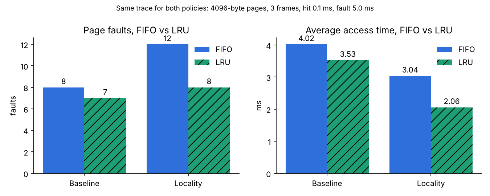

# Milestone 3 results

Generated by `experiments/m3_results.py` from the engine. The same values are checked against hand-worked
numbers in `tests/unit/test_memory_manager.py`, `test_memory_locality.py` and `test_file_manager.py`.

## FIFO vs LRU on identical traces (4096-byte pages, 3 frames, hit 0.1 ms, fault 5.0 ms)

| Trace | Policy | References | Hits | Faults | Evictions | Fault rate (%) | Hit rate (%) | Avg access (ms) |
| --- | --- | --- | --- | --- | --- | --- | --- | --- |
| Baseline trace (10 references) | FIFO | 10 | 2 | 8 | 5 | 80.00 | 20.00 | 4.020 |
| Baseline trace (10 references) | LRU | 10 | 3 | 7 | 4 | 70.00 | 30.00 | 3.530 |
| Locality trace (20 references) | FIFO | 20 | 8 | 12 | 9 | 60.00 | 40.00 | 3.040 |
| Locality trace (20 references) | LRU | 20 | 12 | 8 | 5 | 40.00 | 60.00 | 2.060 |

On the locality trace pages 0 and 1 are re-used constantly. LRU keeps them resident and never evicts them; FIFO evicts them just because they
were loaded first, so it faults 12 times to LRU's 8. On the baseline trace the policies differ by one fault.

## File system: 12-command baseline script (`inputs/fs_baseline.txt`)

12 commands: 9 succeeded, 3 safe errors, 0 denied; 8 B written, 8 B read; 1 directories and 1 files created, 1 and 1 deleted; 0 B stored at the end; average latency 1.83 ms.

| Command | Count | ok | error | denied | Total latency (ms) | Average (ms) |
| --- | --- | --- | --- | --- | --- | --- |
| mkdir | 2 | 1 | 1 | 0 | 4.0 | 2.00 |
| ls | 2 | 2 | 0 | 0 | 2.0 | 1.00 |
| mkfile | 1 | 1 | 0 | 0 | 2.0 | 2.00 |
| write | 1 | 1 | 0 | 0 | 3.0 | 3.00 |
| append | 1 | 1 | 0 | 0 | 3.0 | 3.00 |
| cat | 2 | 1 | 1 | 0 | 2.0 | 1.00 |
| rm | 1 | 1 | 0 | 0 | 2.0 | 2.00 |
| rmdir | 2 | 1 | 1 | 0 | 4.0 | 2.00 |

## File system: 20-command script (`inputs/fs_script.txt`)

20 commands: 15 succeeded, 5 safe errors, 0 denied; 15 B written, 14 B read; 3 directories and 2 files created, 1 and 2 deleted; 0 B stored at the end; average latency 1.90 ms.

| Command | Count | ok | error | denied | Total latency (ms) | Average (ms) |
| --- | --- | --- | --- | --- | --- | --- |
| mkdir | 4 | 3 | 1 | 0 | 8.0 | 2.00 |
| ls | 3 | 3 | 0 | 0 | 3.0 | 1.00 |
| mkfile | 3 | 2 | 1 | 0 | 6.0 | 2.00 |
| write | 2 | 2 | 0 | 0 | 6.0 | 3.00 |
| append | 1 | 1 | 0 | 0 | 3.0 | 3.00 |
| cat | 2 | 1 | 1 | 0 | 2.0 | 1.00 |
| rm | 3 | 2 | 1 | 0 | 6.0 | 2.00 |
| rmdir | 2 | 1 | 1 | 0 | 4.0 | 2.00 |
